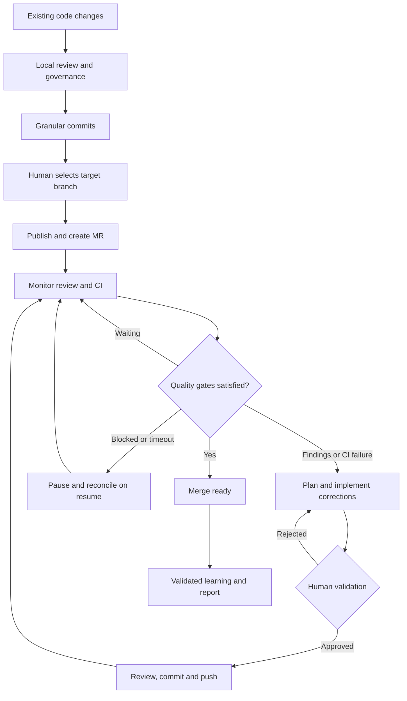

# Delivery Orchestrator

An open-source, local-first engineering control center for AI-powered software delivery.

> **Project status: design and discovery.** The capabilities described below are planned, not implemented. Installation instructions and a runnable demo will be published when available.

## Why this project exists

AI coding agents can implement features, but developers still coordinate reviews, commits, merge requests, CI failures and feedback cycles. Delivery Orchestrator aims to turn these fragmented tasks into a supervised, observable delivery workflow.

## Planned experience

Start a delivery from Cursor or Codex, follow its progress in a local dashboard, and intervene when a decision or functional validation is required. The workflow stops at a merge-ready GitLab merge request; it never merges automatically.

## Planned capabilities

- Project-aware code review using an existing Finding skill or compatible review adapter.
- Granular commits, explicit target selection and GitLab merge request management.
- Feedback-driven correction cycles and CI diagnostics.
- Human-in-the-loop approvals tied to the reviewed code snapshot.
- Persistent workflows, recovery, audit history and real-time dashboard updates.
- Project-isolated, approved and reversible learning from confirmed findings.
- Multiple projects and deliveries; light and dark themes.
- A synthetic demo mode requiring no corporate credentials or paid AI service.

## Design principles

Local-first control data, provider-independent interfaces, explicit workflow transitions, least privilege, and no mandatory additional paid services. Remote GitLab and AI integrations still require appropriate accounts and permissions; provider quotas may apply. No automatic merge or force push.

The proposed architecture includes a workflow core, MCP interface, local API, dashboard, monitoring worker, persistence and integration adapters. Technology choices remain subject to technical discovery and architecture decision records.

## Documentation

- [Product vision](docs/product/PRODUCT_VISION.md)
- [Product requirements](docs/product/PRD.md)
- [Roadmap](docs/ROADMAP.md)
- [Documentation index](docs/README.md)
- [Architecture decisions](docs/adr/README.md)

## Contributing and security

See [CONTRIBUTING.md](CONTRIBUTING.md) and [SECURITY.md](SECURITY.md). Never submit proprietary code, internal review comments, credentials or real customer data. Use synthetic examples.

## License

See [LICENSE](LICENSE) for the repository's existing license.
