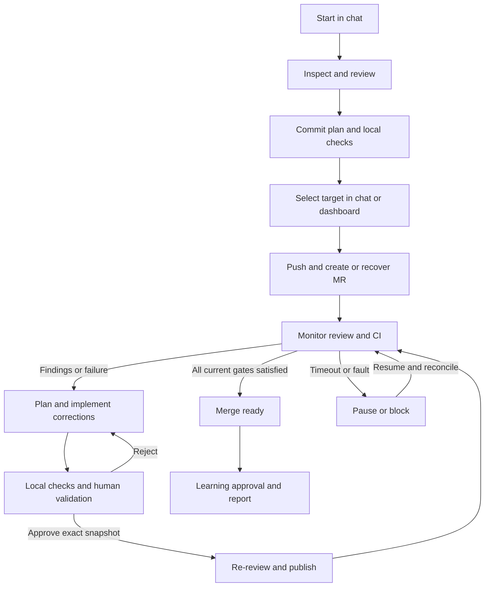

# Interaction flows

Chat and dashboard share the same action ID and state. First valid decision wins; concurrent or stale submissions are rejected and refreshed. A branch change requires target-relative revalidation. Material changes after functional approval invalidate it. The dashboard shows resume instructions if the agent session is no longer active. No automatic merge. Approval of learning is separate from merge readiness.

Workflow nodes represent stages; executions are cycle-specific. Select a node to inspect recorded evidence. Monitoring may observe CI and review independently; a green pipeline alone never indicates completion. Display published SHA, CI SHA, local snapshot, pending gates and freshness. A completed cycle is immutable in the UI.
