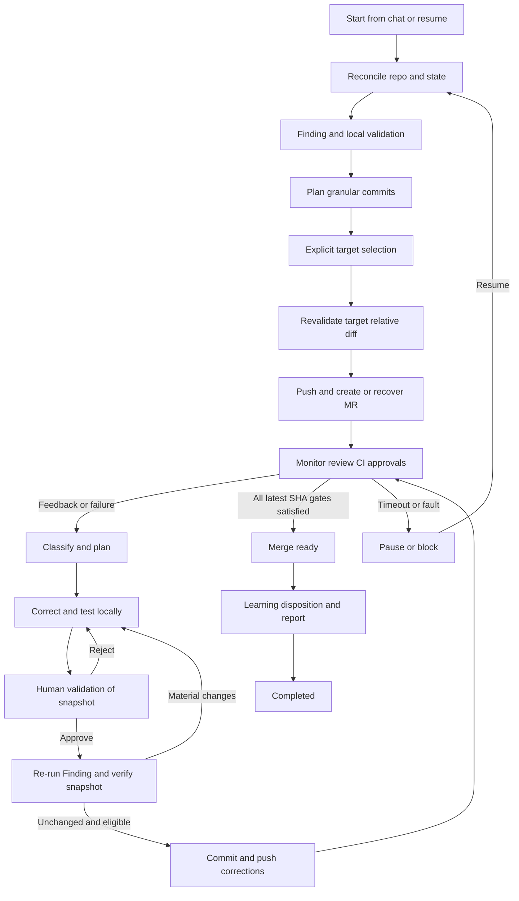

# Interaction Flows

## Delivery lifecycle

Initial granular commits may be created before target selection per original flow; target-relative validation before publication is mandatory. No auto merge or deploy. Reconciliation chooses correct recovery step, not a blind restart. Review and CI can run independently; a silent reviewer or green stale CI never implies readiness.

## Human action protocol

1. Orchestrator records immutable action ID, project, delivery, cycle, type, eligible choices, snapshot when relevant, evidence, timestamps and expiry policy.
2. Action Center and chat display same request; all other screens link to it.
3. User selects branch, confirms checklist/approval, rejects with feedback or approves a permitted exception/learning candidate.
4. Gateway checks identity, pending state, version and current snapshot/policy, then atomically records decision. First valid decision wins; duplicate/replayed/stale submissions return existing outcome or refresh requirement.
5. Workflow resumes only after revalidation; material change invalidates functional approval. If original agent session cannot resume, show manual continuation instructions with durable context.

## Findings, CI and learning

Finding → assessment → plan or authorized dismissal request → correction → tests → human validation → publish → current-SHA verification → resolved. CI failure → job evidence → classification → policy-bound retry or correction → validation → publish/recheck. Never mark resolved from text alone. Learning → extract evidence → deduplicate and scope → candidate → Action Center approval/rejection → version and activate or archive. Rollback is auditable; active rule version is captured in next Finding run. Merge readiness is shown even if learning remains pending.

## Unified demo journey

Start a synthetic delivery; open workflow; choose target in Action Center; inspect a Finding execution; open related finding and failed CI job; view recovery; reject a correction once, approve revised exact snapshot; simulate new published SHA and latest successful review/CI; show MergeReady; approve learning and complete report; inspect shared usage and outcome analytics. No external effects. Include second project with isolated knowledge. Simulate unsupported telemetry and stale action, restart/reconnect, theme/locale change. Data and decisions must propagate to all linked screens without contradictions.

## Failure and recovery

Persist state/events before UI acknowledgement. Recover missing SSE events or fetch current state after reconnect; mark stale until reconciled. Bound retry/backoff and distinguish cancelled, interrupted and failed. A lost push/MR response requires lookup and reconciliation before repeating. Protect concurrent checkouts. Do not infer permission or execute untrusted comments. Cancellation does not undo existing effects. Monitoring polls without consuming AI for simple waiting.
