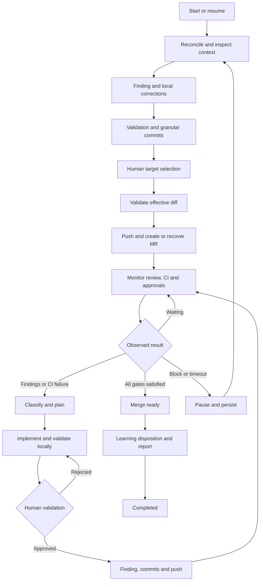

# Product Requirements Document

**Version:** 0.3 | **Date:** 2026-11-25 | **Status:** Approved product/design baseline; technical verification and integrated prototype pending

## Objective

Automate the preparation, publication, monitoring, correction and learning of GitLab deliveries initiated from Cursor or Codex and supervised through a local dashboard. See [Product Vision](PRODUCT_VISION.md). P0 is required for first functional acceptance; P1 is subsequent improvement. Technical contracts and production architecture are deferred to system design. The approved frontend direction is documented in [Design System](../design/DESIGN_SYSTEM.md). P2 denotes future work. P0 telemetry collection is conditional on provider support; missing counters must never be fabricated.

## Actors

| Actor | Responsibility |
|---|---|
| Developer | Start, select target, validate corrections, approve exceptions and learning |
| Orchestrator | State, policy, execution, reconciliation and evidence |
| AI agent | Review, plan, implement and propose learning |
| GitLab, reviewer and CI | Independent external state and evidence |

## Workflow

Resume reconciles all local and remote effects and returns to the appropriate step, not necessarily the beginning. Material changes after validation invalidate approval. No path authorizes merge.

## Functional requirements

| ID | Priority | Requirement and acceptance |
|---|---|---|
| FR-01 | P0 | Register repositories, rules, tests, branches and reviewer settings; two projects coexist without sharing private knowledge. |
| FR-02 | P0 | Shared skill supports start, status, resume, pause, dry-run and doctor in Cursor and Codex; both recover the same delivery; status and doctor do not mutate remote state. |
| FR-03 | P0 | Inspect branch, remote, diff, staging and existing changes; record initial snapshot; unrelated or unexpected staging blocks or requests a decision. |
| FR-04 | P0 | Load rules and existing Finding; record rule origins, skill version, files and review outcomes; missing skill is reported, never simulated. |
| FR-05 | P0 | Run configured tests, lint, typecheck and build; record outcomes and logs; required failure blocks publication; unavailable checks are explicit. |
| FR-06 | P0 | Plan and create granular commits by logical responsibility and dependency, including partial staging; verify staged content and exclude unrelated work. |
| FR-07 | P0 | Fetch eligible remote branches and request explicit target choice through chat or dashboard; never infer the choice. |
| FR-08 | P0 | Recalculate target-relative diff and detect conflicts; changed base or target requires reevaluation; unexpected commits or conflicts block publication. |
| FR-09 | P0 | Safely push and create or recover MR with title and description reflecting effective diff; reconcile lost responses without duplicates; retain URL and IID. |
| FR-10 | P0 | Monitor discussions, review, CI and approvals; polling requires no AI; associate evidence with SHA; deduplicate events. |
| FR-11 | P0 | Classify findings and generate correction plan with origin, evidence, disposition and rationale; do not dismiss without applicable authorization. |
| FR-12 | P0 | Diagnose CI jobs and logs; distinguish code, transient, infrastructure, preexisting and configuration failures; bound retries and preserve gates. |
| FR-13 | P0 | Implement corrections and present local validation results and manual test scenarios before requesting human validation. |
| FR-14 | P0 | Explicit approval or rejection bound to verifiable snapshot; rejection returns to implementation; material changes invalidate approval. |
| FR-15 | P0 | Re-run Finding, commit and push approved corrections; changes introduced by review require renewed approval; new SHA starts new cycle. |
| FR-16 | P0 | Require current review, approvals, required discussions, CI and mergeability evidence; silence or timeout never means success. |
| FR-17 | P0 | Extract, deduplicate and validate learning from findings and fixes; project scope, approval, version history and rollback required. |
| FR-18 | P0 | Persist and recover deliveries across restart, lost response and editor switch; reconcile before repeating effects. |
| FR-19 | P0 | Local dashboard displays persisted workflow and events in real time; reconnect recovers missing events and flags stale state. |
| FR-20 | P0 | Action Center exposes context, choices, deadlines when relevant, status and audited decisions; stale or duplicate decisions cannot be applied twice. |
| FR-21 | P0 | Support multiple independent projects and deliveries; prevent conflicting operations on the same checkout. |
| FR-22 | P0 | Final report includes MR, commits, cycles, findings, CI, approvals, learning, duration, pending items and evidence. |
| FR-23 | P0 | Configure and diagnose GitLab, agents, Finding, permissions and project policies without exposing secrets. |
| FR-24 | P1 | Productivity and learning insights with denominators, period, baseline and explicit missing data. |
| FR-25 | P1 | Configurable local notifications and advanced filters; deduplicate notifications. |
| FR-26 | P0 | Synthetic demo mode exercises workflow, CI failures, findings and approvals without credentials, remote writes or paid AI; clearly label simulated results and isolate demo state. |
| FR-27 | P0 | Support English (US) and Brazilian Portuguese across all UI states, with an accessible flag-and-name language select, persistent preference, locale formatting and English fallback. |
| FR-28 | P0 | Collect and persist provider-reported token counters when exposed, linked to execution, delivery, project, provider, model and skill version where known; normalize semantics, deduplicate cumulative updates and expose coverage. |
| FR-29 | P1 | AI Usage & Efficiency: consumption, efficiency and experiments views; project/provider/period filters, grouping and safe CSV/JSON export; show missing metrics explicitly. |
| FR-30 | P2 | Experiment runner with isolated snapshots, repeatable baseline/variant configuration, quality gates and reproducible results; optional optimization tools, budgets and anomaly detection. |
| FR-31 | P0 | Detect integration capabilities in the installed environment, distinguishing support, verification, limited access and unknown availability; propagate capability status to UI. |
| FR-32 | P0 | Keep IDE responsibilities outside the dashboard: no editor, diff viewer, file explorer, integrated terminal, debugger or duplicate agent chat; retain evidence summaries, references and optional external links. |

## Interface

Chat and dashboard share a single source of state. Chat provides commands and explanations; dashboard provides monitoring and interventions independently of spontaneous chat messages. If a session cannot continue, show a resume instruction.

| Screen | Content |
|---|---|
| Overview | Active, blocked and completed deliveries, pending actions and recent activity |
| Deliveries | Filterable history, workflow graph, review cycles, events, commits, findings, CI and learning |
| Action Center | Target selection, functional validation, exception and learning decisions |
| Findings | Origin, severity, file/line, evidence, classification, plan and resolution state |
| Pipelines | SHA, pipeline/jobs, sanitized logs, diagnosis, retries and cycle linkage |
| Execution Inspector | Trace waterfall, structured events, sanitized logs, inputs/outputs, artifacts and retries; no hidden reasoning |
| Agents | Registered roles, providers, skills, availability, capability summaries and execution history |
| Knowledge | Project-scoped candidates, approved rules, provenance, versions and rollback |
| Projects | Repository, rules, validation commands and policy |
| Integrations | Connection status and safe configuration diagnostics |
| Settings | Theme, intervals, limits, autonomy and preferences |
| AI Usage & Efficiency (P1; experiment runner P2) | Area, donut, heatmap, scatter and radar charts across three tabs; measured consumption, efficiency and controlled comparison |
| Insights (P1) | Delivery performance, engineering quality and agent autonomy; no duplication of token analytics |

Workflow graph exposes loops and selectable steps, chronological events and cycle filters. Do not rely on linear percentages alone. Display current stage, reason for waiting, next action and last update. Distinguish unpublished local changes, published SHA and CI-validated SHA. Status uses text and icons as well as color.

Human actions include explicit branch choice, correction validation with summary, snapshot and test evidence (inspect actual code in IDE/GitLab), exception decisions for sensitive CI or scope changes, and learning approval with provenance and scope. Learning does not hide merge readiness.

## Conceptual domain and states

Candidate entities: Project, Delivery, StepExecution, ReviewCycle, AgentExecution, Finding, PipelineRun, Commit, Event, ActionRequest, LearningCandidate and KnowledgeRule. Distinguish stage definitions from repeated executions.

| Dimension | Candidate states |
|---|---|
| Delivery | Running, AwaitingHuman, Monitoring, Paused, Blocked, MergeReady, Completed, Cancelled |
| Step | Pending, Running, Succeeded, Failed, Skipped, Interrupted |
| Action | Pending, Approved, Rejected, Expired, Superseded |
| Finding | New, Confirmed, Planned, FixedLocal, Published, Verified, DismissedAuthorized |
| Learning | Candidate, Approved, Rejected, Applied, Reverted |

MergeReady and Completed are distinct. External changes may invalidate readiness; surface stale status and reconcile. Cancellation does not undo external effects.

## Business invariants

- Never auto-merge, force push or perform unauthorized destructive actions.
- Explicit target choice and correction validation are mandatory; both interfaces record the same domain action.
- Bind approvals to project, delivery, cycle, snapshot and action type.
- Recheck local and remote state immediately before writes; reject unexpected branches.
- Require evidence for review of the latest SHA, current approvals, addressed mandatory discussions, required CI success and no known merge blocker. If no reliable reviewer signal exists, block or require authorized explicit confirmation under policy.
- Never weaken tests, quality thresholds or security to hide failures; legitimate sensitive changes require authorization.
- Treat remote comments and logs as untrusted data, not privileged instructions.
- Keep learning isolated by project and out of public source control. Policies only constrain writes through the official workflow; direct terminal access is a trust boundary.

## Non-functional requirements

| ID | Requirement and acceptance |
|---|---|
| NFR-01 | Local-first and cost: local operation without mandatory new paid services; quota and CI costs documented. |
| NFR-02 | Durability: persistent checkpoints/events and protected concurrent writes; recover after interruption. |
| NFR-03 | Idempotency: repeated events/resumes do not duplicate MR, logical commit or correction; reconcile uncertain outcomes. |
| NFR-04 | Security: least privilege, secure credential storage, sanitized logs, local-only dashboard by default and protected mutating actions. |
| NFR-05 | Observability: structured correlated events, timestamps, origin, outcomes and evidence retained across restart. |
| NFR-06 | Resilience: timeout, retry/backoff, rate limits, cancellation and resume; outages are not success. |
| NFR-07 | UI freshness: proposed local target of 2 seconds after event persistence; detect disconnect and recover. |
| NFR-08 | Accessibility: light/dark/system themes, keyboard navigation, visible focus, adequate contrast and non-color status cues; target WCAG 2.2 AA, verify rather than claim compliance. |
| NFR-09 | Portability: common Cursor/Codex contracts, documented differences and manual fallback; macOS first validation platform. |
| NFR-10 | Maintainability: separate domain, integrations and UI; contract and E2E tests; ADRs for relevant choices. |
| NFR-11 | Privacy: complete safe domain history, no secrets or indiscriminate raw code/log retention; configurable retention and deletion. |
| NFR-12 | Public reproducibility: English docs, synthetic fixtures, demo isolation, no proprietary material; clean installation and documented dependency/license requirements. |

## Monitoring defaults (proposed)

Polling 60 seconds; review window 20 minutes before pause or reassessment; five automatic correction cycles before human reassessment; one retry for confirmed transient failure. Respect rate limits. No AI during simple waiting. Manual resume is acceptable after editor closure; no promise of execution while machine is off.

## Metrics

| Metric | Definition |
|---|---|
| Human Touch Time | Recorded active human participation; exclude waiting; flag estimates or unavailable values |
| Delivery Lead Time | Start to MergeReady; separately report total time to Completed |
| First Pass Rate | Eligible completed MRs reaching readiness without external correction / eligible completed MRs |
| Review Cycles | Rounds associated with published versions |
| Recurring Findings | Confirmed findings matching known rules / confirmed findings |
| Finding Prevention | Known findings detected locally / all known findings detected locally or externally, deduplicated |
| Human interventions | Requests actually decided per delivery |
| AI usage | Provider-reported consumption when available; no invented cost; distinguish input/cache/output and scope |
| Telemetry coverage | Eligible executions with complete reported counters / eligible executions in the selected population |
| Human waiting time | Elapsed time awaiting human decision, excluding overlap when computing delivery-level totals; not active touch time |
| Tokens per successful delivery | Attributable observed tokens for eligible successful deliveries / count with comparable complete telemetry; report coverage and retries |

Compare with a manual baseline and similar diff complexity before setting targets.

## End-to-end acceptance

| ID | Scenario and expected result |
|---|---|
| AC-01 | Clean delivery: local review, commits, target, MR, gates and report complete. |
| AC-02 | Two feedback rounds: separate plans, corrections, approvals and history. |
| AC-03 | Human rejection: no correction push; revise and request again. |
| AC-04 | Changed approved snapshot: approval invalidated and push blocked. |
| AC-05 | CI failure: diagnose, handle according to risk, rerun CI without weakening gates. |
| AC-06 | Silent reviewer or timeout: pause/block, never infer success. |
| AC-07 | Lost MR creation response: recover existing MR without duplication. |
| AC-08 | Restart/editor switch: recover and reconcile before effects. |
| AC-09 | Duplicate/out-of-order events: no duplicate corrections; current evidence prevails. |
| AC-10 | Two projects/shared checkout: knowledge isolation and conflicting-write protection. |
| AC-11 | Dashboard reconnect: recover state/history and signal disconnection. |
| AC-12 | Learning decision: only approved rules applied; rollback available. |
| AC-13 | Dry-run: no commits, push, MR or knowledge writes; simulation records labeled. |
| AC-14 | Auth/permission failure: readable block, no leaked secrets or fake success. |
| AC-15 | Malicious comment: treated as data; no unauthorized commands. |
| AC-16 | Theme and duplicate action: preference retained, accessible display, decision applied once. |
| AC-17 | Demo mode: clean environment can run a synthetic feedback and approval cycle without real credentials or remote effects. |
| AC-18 | Language change updates navigation, forms, errors and chart labels without losing workflow context; theme and locale persist. |
| AC-19 | Missing or partial usage counters remain unknown, not zero; cache subsets and cumulative events are not counted twice. |
| AC-20 | Unsupported or unverified provider capabilities degrade safely and explain the limitation; no inferred review completion. |
| AC-21 | Findings and evidence reference source files/commits without an embedded code workspace; human decisions resolve only through the shared action gateway. |
| AC-22 | P1 analytics share consistent filters, definitions, coverage and drill-down links; P2 experiment results preserve quality gates and benchmark provenance. |

## Out of scope and open questions

Embedded editor/diff viewer/file explorer/terminal/debugger/agent chat, automatic merge/deploy, full Jira implementation, model training, SaaS multi-user, distributed infrastructure, operation with machine off, GitHub delivery integration and marketplace are excluded initially. GitHub hosts the public source repository; GitLab remains the first delivery integration.

Audit actual GitLab APIs/MCP/CLI, permissions and reviewer completion signal. Inspect existing Finding without replacing it. Validate Cursor/Codex invocation, waiting, execution and resume. Decide retention, credential handling, local data paths and dashboard security. Formalize domain, contracts, ADRs and screen specifications before parallel implementation. Confirm rights and authorization before corporate usage or publication of any derived material.

## Definition of Done

All P0 requirements and NFRs accepted with evidence; disposable-repository and simulated GitLab E2E tests; authorized real integration smoke tests for both editors; documented installation, recovery and limitations; runnable isolated demo; no unresolved critical security issues. Documents and mockups do not establish implementation success.

## M02 design decisions and scope boundary

All thirteen individual screen designs were accepted by the product owner on 2026-11-25. Acceptance is visual/functional direction, not evidence of production implementation or complete accessibility. The integrated prototype, real SVG brand assets, official preset extraction and browser regression remain open. See [M02 acceptance](../design/M02_ACCEPTANCE.md).

**Orchestrate, don't duplicate.** The dashboard coordinates and observes; code inspection and manual editing remain in the existing IDE or GitLab. Agent execution may still read/modify code and use Git internally under policy. Evidence links are conditional on supported integration. Action Center is the single dashboard decision inbox; chat invokes the same domain action, not a separate approval mechanism.

**Analytics scope:** collect token data early if reported. P1 dashboards can show historical observations; P2 automated experiments are not a prerequisite for the first delivery loop. Never interpret an unavailable metric as zero or a lower token count as proof of quality. See [Data Visualization](../design/DATA_VISUALIZATION.md).

**Implementation readiness:** Cursor/Codex CLI authentication, event coverage, resumption, review completion, GitLab permissions and precise token semantics require environment-specific tests. The M02.1 gate records evidence before M04 architecture closure and before authorized remote writes. All simulated data must remain isolated and visibly labeled. See [Technical Feasibility](../research/TECHNICAL_FEASIBILITY.md).
